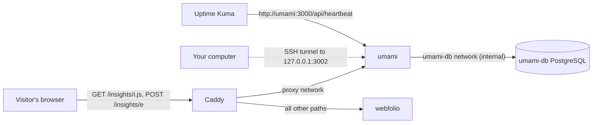

# Visit statistics (Umami)

Self-hosted, cookieless visit statistics with [Umami](https://umami.is) on the VPS. Umami counts page views, referrers, browsers, devices and countries. It sets no cookies and stores no IP addresses, so the site needs no consent banner. The privacy note at `/privacy` describes it to visitors.

Follow the steps in sequence. Each step tells you **where** you do it, **what** you do, the **expected result** and **why**. The site address is `barooni.dev`. Replace it if you use this guide for another domain.

## Where you see the statistics

The statistics are in the Umami dashboard. It is not on the internet. Open an SSH tunnel from your computer and keep the terminal open:

```bash
ssh -L 3002:127.0.0.1:3002 -N myserver
```

Then open `http://localhost:3002` in your browser and log in as `admin` with the password you set in [step 6](#6-change-the-admin-password-and-add-the-website). Choose the website `barooni.dev`. **Overview** shows visitors, page views, pages, referrers, countries, browsers and devices for a time range. **Realtime** shows the last 30 minutes. To see one language, filter by a path that starts with `/de` or `/nl`. For read-only access without the tunnel, for example on a phone, see [Open the dashboard later](#open-the-dashboard-later).

## Overview

- **Two containers** – `umami` (web app, dashboard and event API) and `umami-db` (PostgreSQL). No ClickHouse, no Redis.
- **Dashboard over an SSH tunnel** – the dashboard is published only on `127.0.0.1:3002` of the server, like [Uptime Kuma](setup-monitoring.md).
- **Only two public paths** – Caddy forwards `https://barooni.dev/insights/i.js` (the tracker script) and `https://barooni.dev/insights/e` (the event endpoint) to Umami. Nothing else of Umami is public.
- **Same origin** – the tracker loads from the site's own address, so no Content Security Policy change is needed later, and fewer content blockers stop it.
- **Pinned images** – both images are pinned by tag and digest.
- **Off until you switch it on** – the site loads the tracker only when `websiteId` in `frontend/ui/src/app/config/analytics.ts` is set. Until then, nothing is sent.

### How the parts connect



### What the site does

- The Angular app loads the tracker after the first page opened that is not the access screen. A visitor who must stay on the access screen never loads it. A filter in the page also drops any event of the access screen. See `frontend/ui/src/app/visit-statistics/visit-statistics.ts`.
- The tracker counts each page change of the single-page app by itself. `/de/...` and `/nl/...` are separate paths, so you can filter the statistics by language with the path.
- Query strings and fragments are not sent. Visitors with "Do Not Track" are not counted.
- The tracker runs only on `barooni.dev`. Local runs and the prerender step send nothing.

### Order of the steps

| Step | Where                   | What                                       |
| ---- | ----------------------- | ------------------------------------------ |
| 1    | VPS over SSH            | Check the images                           |
| 2–4  | VPS, local Mac terminal | Create the folder, copy files, set `.env`  |
| 5    | VPS over SSH            | Start Umami                                |
| 6    | Browser via tunnel      | Change the admin password, add the website |
| 7    | VPS over SSH            | Update the Caddyfile                       |
| 8    | Repository              | Set the website ID and publish the site    |
| 9    | Browser                 | Check that visits arrive                   |
| 10   | Uptime Kuma, VPS        | Monitoring and backups                     |

## Before you start

- [ ] The server runs as in [setup-server.md](setup-server.md): Docker, Caddy, the `proxy` network.
- [ ] You can log in over SSH (`ssh myserver` or `ssh holu@<SERVER_IP>`).
- [ ] The server has about 600 MB free RAM and 2 GB free storage. Umami is limited to 512 MB and PostgreSQL to 256 MB. A personal site uses much less disk than that.

## Decisions and why

| Decision                                                    | Why                                                                                                                                                   |
| ----------------------------------------------------------- | ----------------------------------------------------------------------------------------------------------------------------------------------------- |
| Umami, not Plausible Community Edition                      | One app and PostgreSQL. Plausible also needs ClickHouse and about 2 GB of RAM, and two databases to back up and upgrade.                              |
| Dashboard on `127.0.0.1:3002` and an SSH tunnel             | The login page is not on the internet. Only someone with SSH access can reach it.                                                                     |
| Tracker paths on `barooni.dev`, not `analytics.barooni.dev` | Same origin: no extra DNS record, no extra certificate, no CSP entry, and block lists that match Umami's default names do not match `/insights/i.js`. |
| `COLLECT_API_ENDPOINT=/insights/e`                          | Umami writes this path into the tracker script when it starts. Caddy then forwards only this path, not the whole Umami API.                           |
| Database on an `internal` network                           | The database has no route to the internet, and Caddy cannot reach it.                                                                                 |
| Telemetry and update check off                              | Umami does not call home. You learn about updates from the release page (see [Updates](#updates)).                                                    |
| The tracker loads after the access check                    | Visitors who must stay on the access screen are not counted.                                                                                          |

## Setup

### 1. Check the images

**Where:** VPS over SSH.

```bash
docker buildx imagetools inspect ghcr.io/umami-software/umami:3.5.0 | grep -m1 Digest
docker buildx imagetools inspect postgres:17.12-alpine | grep -m1 Digest
```

**Expected result:** the Umami digest is the same as in `deploy/umami/compose.yaml`. **Why:** with `tag@digest`, Docker uses only the digest. The check proves that the pinned image is the published one.

The official PostgreSQL images are rebuilt often, so the `17.12-alpine` tag can point to a newer digest than the one in the file. That is normal. Use the new digest in `compose.yaml` on the server and in the repository.

### 2. Create the folder

**Where:** VPS over SSH.

```bash
sudo mkdir -p /opt/docker/umami
sudo chown $(whoami):docker /opt/docker/umami
chmod 750 /opt/docker/umami
```

**Expected result:** `ls -ld /opt/docker/umami` shows `drwxr-x--- holu docker`.

### 3. Copy the files to the server

**Where:** local Mac terminal, in the repository folder.

```bash
scp deploy/umami/compose.yaml deploy/umami/.env.example myserver:/opt/docker/umami/
# or typed out:
scp deploy/umami/compose.yaml deploy/umami/.env.example holu@<SERVER_IP>:/opt/docker/umami/
```

### 4. Create the `.env` file

**Where:** VPS over SSH.

```bash
cd /opt/docker/umami
cp .env.example .env
sed -i "s/<DB_PASSWORD>/$(openssl rand -hex 32)/" .env
sed -i "s/<APP_SECRET>/$(openssl rand -hex 32)/" .env
chmod 600 .env
chmod 640 compose.yaml
rm .env.example
```

**Expected result:** `grep -c '<' .env` prints `0`. **Why:** the password is part of the database URL, so it must not contain characters such as `@` or `/`. Hex is safe. `.env` holds secrets, so only you can read it. See [file-permissions.md](file-permissions.md).

### 5. Start Umami

**Where:** VPS over SSH.

```bash
cd /opt/docker/umami
docker compose config --quiet
docker compose up -d
docker compose ps
docker compose logs umami | grep -i "tracker endpoint"
```

**Expected result:** both containers show `Up` and, after a minute, `healthy`. The log shows `Updated tracker endpoint: /insights/e.`. `sudo ss -tlpn | grep 3002` shows only `127.0.0.1:3002`. `docker network inspect umami-db --format '{{.Internal}}'` prints `true`.

**Why the log line matters:** without it, the tracker sends to `/api/send`, which Caddy does not forward.

### 6. Change the admin password and add the website

**Where:** local Mac terminal, then browser.

Open a tunnel. Keep this terminal open while you use the dashboard:

```bash
ssh -L 3002:127.0.0.1:3002 -N myserver
# or typed out:
ssh -L 3002:127.0.0.1:3002 -N holu@<SERVER_IP>
```

Open `http://localhost:3002`. Log in with the default user `admin` and the password `umami`. Then, at once:

1. **Settings > Profile > Change password**: set a long unique password and save it in your password manager.
2. **Settings > Websites > Add website**: name `barooni.dev`, domain `barooni.dev`.
3. Open the new website and copy its **Website ID** (a UUID).

**Why at once:** every new Umami has the same default login. The tunnel protects it, but change it before you do anything else.

### 7. Update the Caddyfile

**Where:** local Mac terminal, then VPS over SSH.

The repository's `deploy/caddy/Caddyfile` already has the two `handle` blocks for `/insights/...`. Copy it and reload Caddy:

```bash
scp deploy/caddy/Caddyfile myserver:/opt/docker/caddy/Caddyfile
```

```bash
cd /opt/docker/caddy
docker compose exec caddy caddy validate --config /etc/caddy/Caddyfile
docker compose exec caddy caddy reload --config /etc/caddy/Caddyfile
curl -sI https://barooni.dev/insights/i.js | head -1
curl -s https://barooni.dev/insights/i.js | grep -c "/insights/e"
```

**Expected result:** `Valid configuration`, then `HTTP/2 200`, then `1`. The site itself still opens as before.

### 8. Set the website ID and publish the site

**Where:** repository.

In `frontend/ui/src/app/config/analytics.ts`, set `websiteId` to the ID from step 6. The ID is not a secret: every visitor sees it in the page. Commit, merge to `main`, publish the image and update the `webfolio` container as usual (see [server-housekeeping.md](server-housekeeping.md#updating-a-service)).

**Why a code change:** the site loads the tracker only when an ID is set. This keeps the tracker off until Umami runs, so the site never asks for a script that does not exist.

### 9. Check that visits arrive

**Where:** browser.

1. Open `https://barooni.dev` in a private window, with no content blocker and no "Do Not Track".
2. In the developer tools, the network tab shows `i.js` and a `POST` to `/insights/e` with status `200`.
3. Open another page, for example `/de/projects`. A second `POST` follows.
4. In the dashboard (through the tunnel), **Realtime** shows the visit and both paths.

**Check the visitor addresses:** in **Realtime**, the country must be yours, not "Unknown". If all visits show "Unknown" or the same location, Caddy does not see the real visitor IP address. Umami then counts different visitors with the same browser as one. See [Troubleshooting](#troubleshooting).

**Do not count your own visits:** on each of your browsers, open `https://barooni.dev`, open the developer console and run:

```js
localStorage.setItem("umami.disabled", "1");
```

### 10. Monitoring and backups

**Monitoring.** In Uptime Kuma, add two monitors:

| Monitor type | URL                                 | Why                                              |
| ------------ | ----------------------------------- | ------------------------------------------------ |
| HTTP(s)      | `http://umami:3000/api/heartbeat`   | Umami and its database run (internal check)      |
| HTTP(s)      | `https://barooni.dev/insights/i.js` | The public path through Caddy works for visitors |

**Backups.** Set up the nightly dump in [Backups](#backups).

## Open the dashboard later

Open the tunnel from step 6 and go to `http://localhost:3002`. Close the tunnel with `Ctrl+C` when you are done.

On a phone, you can use the WireGuard VPN ([setup-vpn.md](setup-vpn.md)) and an SSH app with port forwarding, or read the numbers from a share link. A share link (in the settings of the website, **Share URL**) is public and read-only. Anyone with the link can see the statistics, so use it only if that is fine for you.

## Add more sites or apps later

One Umami serves any number of websites. Each one gets its own Website ID.

**Another website on this server.** Add the website in the dashboard (step 6). In the Caddyfile block of that domain, add the same two `handle` blocks as for `barooni.dev`. On that site, load the tracker with its own ID:

```html
<script defer src="/insights/i.js" data-website-id="<WEBSITE_ID>" data-domains="other.example.com" data-do-not-track="true" data-exclude-search="true"></script>
```

**A website on another server.** Load the script from `https://barooni.dev/insights/i.js` and add `data-host-url="https://barooni.dev"`, so the events go to `https://barooni.dev/insights/e`. Mention it in that site's privacy note, because the visitor's browser then also connects to barooni.dev.

**An app or a service** (for example a Capacitor app or a backend job). Send events over HTTP to the same endpoint:

```bash
curl -X POST https://barooni.dev/insights/e \
  -H "Content-Type: application/json" \
  -H "User-Agent: Mozilla/5.0 (compatible; my-app/1.0)" \
  -d '{"type":"event","payload":{"website":"<WEBSITE_ID>","hostname":"app.example.com","url":"/settings","name":"settings-opened","language":"en"}}'
```

Umami drops requests without a browser-like `User-Agent` as bots. Create one website in the dashboard per app, so the numbers stay apart. See the [Umami API docs](https://umami.is/docs/api/sending-stats).

**Custom events on this site.** Add `data-umami-event="<name>"` to a button or link, for example the contact form's send button. Umami counts each click as an event.

Every new site or event type must also be in the privacy note of that site.

## Updates

Umami runs its database migrations when it starts.

1. Read the [Umami release notes](https://github.com/umami-software/umami/releases). Look for breaking changes, especially for a new major version.
2. Get the digest of the new version on the VPS:

```bash
docker buildx imagetools inspect ghcr.io/umami-software/umami:<NEW_VERSION> | grep -m1 Digest
```

3. Make a backup (below). In `compose.yaml`, change the tag and the digest, then:

```bash
cd /opt/docker/umami && docker compose pull && docker compose up -d
docker compose logs --tail=50 umami
```

4. Check step 5 (log line) and step 9 (a visit arrives).
5. Do the same change in the repository, so that `deploy/umami/compose.yaml` matches the server.

**Rollback:** an old image may not work with a migrated database. Restore the backup from step 3 and use the old image.

**PostgreSQL:** update within major version 17 like Umami (new tag and digest). A new major version (for example 18) cannot read the old data folder. Move with a dump: back up, stop, delete the volume, start the new version, restore.

## Backups

Umami keeps everything in PostgreSQL. A backup is one database dump plus the `.env` file.

### Manual backup

```bash
mkdir -p ~/umami-backup-$(date +%F)
cd ~/umami-backup-$(date +%F)
docker compose -f /opt/docker/umami/compose.yaml exec -T db \
  pg_dump -U umami --format=custom umami > umami.dump
cp /opt/docker/umami/.env ./umami.env
chmod 600 umami.dump umami.env
ls -lh umami.dump
```

**Expected result:** `umami.dump` is not empty. **Why `exec`:** `pg_dump` runs inside the database container, so the database needs no port and no password on the host. `--format=custom` is compressed and lets `pg_restore` restore single tables.

Copy the folder off the server, then delete it on the server. `umami.env` holds the database password and the app secret.

### Nightly backup

Create `/opt/docker/umami/backup.sh`:

```bash
#!/usr/bin/env bash
# Nightly Umami dump. Keeps the last 14 dumps.
set -euo pipefail
target=/opt/docker/umami/backups
mkdir -p "$target"
docker compose -f /opt/docker/umami/compose.yaml exec -T db \
  pg_dump -U umami --format=custom umami > "$target/umami-$(date +%F).dump"
find "$target" -name 'umami-*.dump' -mtime +14 -delete
```

```bash
chmod 750 /opt/docker/umami/backup.sh
crontab -e
# add this line: every night at 03:30
30 3 * * * /opt/docker/umami/backup.sh
```

**Expected result:** the next morning, `ls -lh /opt/docker/umami/backups` shows one dump. Copy the dumps off the server with your other backups.

### Restore

```bash
cd /opt/docker/umami
docker compose stop umami
docker compose exec -T db pg_restore -U umami -d umami --clean --if-exists < umami.dump
docker compose start umami
```

On a new server, first do setup steps 2 to 5 with the old `.env` (`umami.env`), then restore. Log in with the old admin password.

## Troubleshooting

**The tracker script gives 502.** Umami is not running, or it is not on the `proxy` network. `docker network inspect proxy | grep umami` must print a line.

**`POST /insights/e` gives 404.** The log line from step 5 is missing. Check `COLLECT_API_ENDPOINT` in `compose.yaml` and recreate the container: `docker compose up -d --force-recreate umami`.

**No events, but the script loads.** Check, in this order: `websiteId` in `config/analytics.ts` matches the dashboard; you did not set `umami.disabled` in this browser; "Do Not Track" is off; the page address is `barooni.dev`, not `www` or a preview.

**All visits show "Unknown" country or one location.** Caddy sees the Docker gateway address, not the visitor, and passes that on to Umami. Test it: open the site from your phone on mobile data and from your computer on Wi-Fi. If **Realtime** shows both with the same location or as "Unknown", the address is wrong.

The usual cause is Docker's userland proxy for IPv6 traffic. Two fixes, both outside this stack: enable IPv6 for Docker with `"ipv6": true`, `"ip6tables": true` and `"userland-proxy": false` in `/etc/docker/daemon.json`, or run Caddy with `network_mode: host`. Test either change on a quiet evening, because it restarts all containers.

**A content blocker stops the tracker.** Some visitors block all statistics. That is their choice. The numbers are a lower bound, not exact.

## Hardening checklist

- [ ] The admin password is changed and stored in the password manager.
- [ ] `sudo ss -tlpn | grep 3002` shows only `127.0.0.1`.
- [ ] `docker network inspect umami-db --format '{{.Internal}}'` prints `true`.
- [ ] `https://barooni.dev/api/heartbeat` and `https://barooni.dev/login` do not reach Umami (the site's own 404 page).
- [ ] `.env` has mode `600`.
- [ ] Nightly dumps exist and are copied off the server.
- [ ] Uptime Kuma checks both monitors from step 10.
