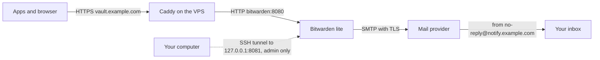

# Bitwarden lite

Self-hosted password manager via [Bitwarden lite](https://bitwarden.com/help/install-and-deploy-lite/) on the VPS. It runs as one container behind the existing Caddy reverse proxy. The vault is at `https://vault.example.com`.

Follow the steps in sequence. Each step tells you **where** you do it, **what** you do, the **expected result** and **why**. Replace `example.com` with your domain in all steps.

## Overview

- **One container** – web vault, API, admin panel, notifications and icons. An internal nginx serves them on port 8080.
- **SQLite** – the database is one file in the data folder. There is no database container.
- **No public ports** – Caddy terminates TLS and sends plain HTTP to `bitwarden:8080` over the `proxy` network. The only published port is `8081` on the loopback address `127.0.0.1`, for the admin panel over an SSH tunnel.
- **Rootless and read-only** – the container runs as UID `911` with a read-only root file system and no capabilities.
- **Pinned image** – `ghcr.io/bitwarden/lite` is pinned by tag and digest. It never uses `latest`.
- **Mail** – a transactional mail provider sends the mail over SMTP. No mail server runs on the VPS.

Bitwarden says that lite is for personal use and home labs, not for businesses.

### How the parts connect



Caddy blocks `/admin` on the public address. You reach the admin panel only through an SSH tunnel, see [Reach the admin panel safely](#reach-the-admin-panel-safely).

The setup has **two separate DNS parts**. Both are records in the DNS settings of `example.com`:

| Part    | Name                 | Points to          | Purpose                             |
|---------|----------------------|--------------------|-------------------------------------|
| Vault   | `vault.example.com`  | Your server        | Apps and browsers find the vault    |
| Sending | `notify.example.com` | Your mail provider | Receivers trust mail from the vault |

### Order of the steps

| Step | Where                       | What                                      |
|------|-----------------------------|-------------------------------------------|
| 1    | DNS provider                | Point `vault.example.com` to the server   |
| 2    | Mail provider, DNS provider | Set up `notify.example.com` and an API key ([setup-mail-sending.md](setup-mail-sending.md)) |
| 3    | Browser                     | Get the Bitwarden installation ID and key |
| 4–11 | VPS over SSH, local machine | Install and start Bitwarden               |
| 12–13| Browser, your devices       | Create the account and connect the apps   |

## Before you start

- [ ] The server runs as in [setup-server.md](setup-server.md): Docker, Caddy, the `proxy` network, ports 80 and 443 open.
- [ ] You can log in over SSH, either with a Host alias from `~/.ssh/config` (`ssh myserver`) or typed out (`ssh holu@<SERVER_IP>`). This guide shows both forms where you type an SSH command.
- [ ] You can edit the DNS records of `example.com` at your DNS provider. This is often the company where you bought the domain.
- [ ] You have an account at a transactional mail provider. This guide uses Resend as a worked example. Other providers have similar screens.
- [ ] You have a password manager or a safe place for secrets. You get secrets in steps 2 and 3.
- [ ] The server has at least 200 MB free RAM and 1 GB free storage.

Write down these values while you work. You need them in step 7. Keep the secret values out of chats, notes apps and the repository.

| Value               | Example                       | Secret | You get it in                      |
|---------------------|-------------------------------|--------|------------------------------------|
| Server IP           | `<SERVER_IP>`                 | No     | Your hosting dashboard (step 1)    |
| Sending subdomain   | `notify.example.com`          | No     | Your choice (step 2)               |
| Sender address      | `no-reply@notify.example.com` | No     | Your choice (step 2)               |
| SMTP host and port  | `smtp.resend.com`, `2465`     | No     | Mail provider docs (step 2)        |
| SMTP user and key   | `resend`, the API key         | Key    | Mail provider (step 2)             |
| Installation ID/key | `<INSTALLATION_ID>`, `<INSTALLATION_KEY>` | Yes | bitwarden.com/host (step 3) |
| Proxy subnet        | `<PROXY_SUBNET>`              | No     | Server command (step 7)            |
| Admin address       | Your own email address        | No     | Your choice (step 7)               |

New to DNS words such as A, MX, TXT, SPF or TTL? Read [DNS words in plain English](setup-mail-sending.md#dns-words-in-plain-english) first.

## Setup

### 1. Point vault.example.com to the server

**Where:** DNS provider dashboard, DNS settings of `example.com`.

Add one record:

| Type | Host name | Value         | TTL     |
|------|-----------|---------------|---------|
| A    | `vault`   | `<SERVER_IP>` | Default |

An A record points a name to an IPv4 address. Many panels add `.example.com` for you, so you type only `vault`. Most panels show a preview. It must show `vault.example.com`, not `vault.example.com.example.com`. Add an `AAAA` record with the server's IPv6 address only if IPv6 already works for your other sites.

**Expected result:** on your local machine, this command prints `<SERVER_IP>`. It can take some minutes.

```bash
dig +short vault.example.com
```

**Why:** Caddy gets the TLS certificate only when the name points to the server.

### 2. Set up mail sending

**Where:** mail provider dashboard and DNS provider dashboard.

Follow [setup-mail-sending.md](setup-mail-sending.md). It explains the sending subdomain `notify.example.com`, every DNS record and every form field. Then come back here.

**Expected result:** the domain `notify.example.com` is **Verified** at the mail provider, and you have the SMTP host, port, user and API key.

**Why:** Bitwarden sends verification mails, admin login links and alerts. Without mail, you cannot verify your account or open the admin panel.

### 3. Get the installation ID and key

**Where:** browser, [bitwarden.com/host](https://bitwarden.com/host/).

1. Enter an email address. You do not need a Bitwarden account.
2. Select the data region, **EU** or **US**. This matters only for a Premium license later. That license must come from a Bitwarden cloud account in the same region.
3. Copy the installation ID and the installation key into your password manager.

**Expected result:** you have an ID like `xxxxxxxx-xxxx-xxxx-xxxx-xxxxxxxxxxxx` and a key. Use them for one installation only.

You create your real vault account later, on your own server (step 12).

### 4. Check Docker and the clock

**Where:** VPS over SSH.

```bash
docker version --format '{{.Server.Version}}'
timedatectl status
```

**Expected result:** Docker is 26 or newer, and `timedatectl` shows `System clock synchronized: yes`. If not, turn on NTP:

```bash
sudo timedatectl set-ntp true
```

**Why:** two-step login codes fail when the clock is wrong.

### 5. Create the directory

**Where:** VPS over SSH.

```bash
sudo mkdir -p /opt/docker/bitwarden
sudo chown $(whoami):docker /opt/docker/bitwarden
chmod 750 /opt/docker/bitwarden

cd /opt/docker/bitwarden
mkdir -p bwdata logs backups
sudo chown 911:911 bwdata logs backups
sudo chmod 700 bwdata logs backups
```

**Why:** the container runs as UID `911`, so it must own the data folders.

| Path       | Mounted at           | Contents                                      |
|------------|----------------------|-----------------------------------------------|
| `bwdata/`  | `/etc/bitwarden`     | `vault.db`, data-protection keys, attachments |
| `logs/`    | `/var/log/bitwarden` | Application and backup logs                   |
| `backups/` | `/backups`           | Built-in daily backup archives                |

### 6. Copy the files to the server

**Where:** local machine, in the repository folder.

```bash
scp deploy/bitwarden/compose.yaml deploy/bitwarden/settings.env.example holu@<SERVER_IP>:/opt/docker/bitwarden/
```

With a Host alias, write `myserver:/opt/docker/bitwarden/` instead of `holu@<SERVER_IP>:/opt/docker/bitwarden/`.

### 7. Configure settings.env

**Where:** VPS over SSH.

Find the subnet of the `proxy` network:

```bash
docker network inspect proxy --format '{{range .IPAM.Config}}{{.Subnet}}{{end}}'
```

**Expected result:** one subnet in CIDR form: an address, a slash and a number. This is your `<PROXY_SUBNET>`. Bitwarden trusts the client IP that Caddy forwards only from this subnet.

Create `settings.env` and replace every placeholder in angle brackets:

```bash
cd /opt/docker/bitwarden
cp settings.env.example settings.env
nano settings.env
```

| Variable                                    | Value                                    |
|---------------------------------------------|------------------------------------------|
| `BW_DOMAIN`                                 | `vault.example.com`                      |
| `BW_INSTALLATION_ID`, `BW_INSTALLATION_KEY` | From step 3                              |
| `BW_REAL_IPS`                               | The proxy subnet                         |
| `globalSettings__mail__replyToEmail`        | `no-reply@notify.example.com`            |
| `globalSettings__mail__smtp__*`             | Host, port, `ssl`, user and key (step 2) |
| `adminSettings__admins`                     | Your own email address                   |

The sender address must be on the verified subdomain. The admin address receives the login link for the admin panel. Paste secrets only into `settings.env` on the server. Never write them into a file in the repository.

### 8. Set file permissions

**Where:** VPS over SSH.

```bash
chmod 640 /opt/docker/bitwarden/compose.yaml
chmod 600 /opt/docker/bitwarden/settings.env
rm /opt/docker/bitwarden/settings.env.example
```

See [file-permissions.md](file-permissions.md) for the full list.

Then store a copy of the finished `settings.env` in a safe place off the server, for example as a secure note or attachment in your password manager.

**Why:** Bitwarden's built-in daily backup does **not** include `settings.env`. Without it, a restore needs a new installation ID and key and the SMTP settings again. See [Backups](#backups-planned).

### 9. Check the image digest

**Where:** VPS over SSH.

```bash
docker buildx imagetools inspect ghcr.io/bitwarden/lite:2026.10.1 | grep -m1 Digest
```

**Expected result:** the digest is the same as the digest in `compose.yaml`. **Why:** with `tag@digest`, Docker uses only the digest. The check proves that the pinned image is the published one.

### 10. Add the Caddy site block

**Where:** VPS over SSH, in `/opt/docker/caddy/Caddyfile`.

```
vault.example.com {
    header {
        Strict-Transport-Security "max-age=31536000; includeSubDomains"
        -Server
    }

    reverse_proxy bitwarden:8080
}
```

**Why:** Bitwarden's nginx sends the other security headers, but it sends HSTS only with its own TLS. Caddy passes the `Host` header and the websocket for `/notifications/hub` by default.

### 11. Start Bitwarden and reload Caddy

**Where:** VPS over SSH.

```bash
cd /opt/docker/bitwarden
docker compose config --quiet
docker compose up -d
docker compose logs -f
```

The first start creates the keys and the database. Stop the log view with `Ctrl+C`. Then reload Caddy:

```bash
cd /opt/docker/caddy
docker compose exec caddy caddy validate --config /etc/caddy/Caddyfile
docker compose exec caddy caddy reload --config /etc/caddy/Caddyfile
curl -s https://vault.example.com/alive
```

**Expected result:** `docker compose ps` in `/opt/docker/bitwarden` shows `healthy` for `bitwarden`, and the `curl` command prints a timestamp.

### 12. Create your account and close registration

**Where:** browser, then VPS over SSH.

The browser is the normal browser on your local machine. No VPN is needed: Caddy serves the vault on the public internet, like your website. Later, [Reach the admin panel safely](#reach-the-admin-panel-safely) blocks `/admin` on the public site for good, and you use the panel through an SSH tunnel.

1. Open `https://vault.example.com` and create your account. Use a long master password that you use nowhere else.
2. Verify your email address. This is the first mail test.
3. Open `https://vault.example.com/admin` and enter the admin address. A login link comes by mail. This is the second mail test.
4. On the VPS, set `globalSettings__disableUserRegistration=true` in `settings.env`.
5. Recreate the container. A restart does not read `settings.env` again:

```bash
cd /opt/docker/bitwarden && docker compose up -d --force-recreate
```

6. In a private browser window, try to create an account.

**Expected result:** the vault shows an error that registration is disabled.

### 13. Connect the apps

**Where:** each device.

Install the official desktop, mobile or browser app. On the login screen, open the server or region selector, choose **Self-hosted** and enter `https://vault.example.com`. Then log in.

## Troubleshooting

**Mail problems** (domain stays pending, `dig` shows nothing, mail does not arrive or goes to spam). See [Troubleshooting in setup-mail-sending.md](setup-mail-sending.md#troubleshooting).

**Caddy does not get a certificate.** Check `dig +short vault.example.com` (step 1). Make sure that ports 80 and 443 are open in `ufw` and in the Hetzner firewall. Read the error:

```bash
cd /opt/docker/caddy && docker compose logs caddy | grep -i vault.example.com
```

**You cannot open the admin panel.** Your address must be in `adminSettings__admins` exactly as you type it. The login link comes by mail, so mail must work first. After [Reach the admin panel safely](#reach-the-admin-panel-safely), `https://vault.example.com/admin` always shows 403. This is correct. Open `http://localhost:8081/admin` through the SSH tunnel instead, and change the start of the mailed login link to `http://localhost:8081`.

**The tunnel says `Address already in use` or `Could not request local forwarding`.** Another program on your computer uses port 8081. Pick a different port on your side. Only the left number changes:

```bash
ssh -L 9081:127.0.0.1:8081 myserver
# or typed out:
ssh -L 9081:127.0.0.1:8081 holu@<SERVER_IP>
```

With a `LocalForward` entry, change it to `LocalForward 9081 127.0.0.1:8081`. Then open `http://localhost:9081/admin`, and change the start of the login link to `http://localhost:9081`.

**The browser or SSH shows `connection refused` or `channel 2: open failed` on localhost:8081.** On the server, check that the container runs and that the port is published:

```bash
cd /opt/docker/bitwarden
docker compose ps
docker compose port bitwarden 8080
```

`docker compose ps` must show `bitwarden` as `healthy`, and `docker compose port` must print `127.0.0.1:8081`. If it prints nothing, the `ports` line is missing in `compose.yaml`. Add it and run `docker compose up -d` (see [step 2 of the admin section](#2-publish-the-admin-port-on-loopback-only)). If SSH says `administratively prohibited`, port forwarding is off on the server: `sudo sshd -T | grep -i allowtcpforwarding` must show `yes`.

**The admin panel complains about the address, or the login link does not work on localhost.** The Bitwarden admin panel has no check that the browser address matches `BW_DOMAIN`, and its login cookie works on `http://localhost`. So it is expected to work through the tunnel. The one place where the domain shows is the mailed login link, which always points to `https://vault.example.com/admin/...`. Change only the start to `http://localhost:8081` and keep the rest. Open the changed link in the same browser within 15 minutes. If it still fails, request a new link through the tunnel and try again. Do not remove the Caddy block to work around it.

**Create account still works after you closed registration.** You probably used `restart`. Run `docker compose up -d --force-recreate`. Then check the value in the container:

```bash
cd /opt/docker/bitwarden && docker compose exec bitwarden printenv globalSettings__disableUserRegistration
```

It must print `true`. The web vault can still show the **Create account** link. The real test is that the registration fails.

## Hardening

- **Two-step login** – turn it on in **Settings > Security > Two-step login**. Use an authenticator app or a FIDO2 key. Keep the recovery code offline.
- **Master password** – Bitwarden cannot reset it. Keep a copy offline.
- **Native apps** – prefer them. The web vault loads its code from the server on each visit.
- **No public port 8080 or 8081** – `sudo ss -tulpn` must not show 8080 at all, and must show 8081 only on `127.0.0.1`.
- **HTTPS only** – `curl -sI http://vault.example.com` must return a redirect to HTTPS.
- **SSH** – a file in `/etc/ssh/sshd_config.d/` can override `sshd_config`. Check the effective values with `sudo sshd -T | grep -Ei 'permitrootlogin|passwordauthentication|pubkeyauthentication'`.
- **Security updates** – run `sudo apt install unattended-upgrades -y`, then `sudo dpkg-reconfigure -plow unattended-upgrades`.

### Reach the admin panel safely

You need the admin panel rarely, mostly once during setup. The panel stays blocked on the public site **all the time**. When you need it, you reach it through an SSH tunnel from your own computer. Do this after step 12.

The idea in short:

- **Caddy** answers every request for `/admin` on `https://vault.example.com` with `403 Forbidden`. You never remove this block.
- **Docker** makes Bitwarden reachable on port `8081` of the server, but only on the loopback address `127.0.0.1`. The loopback address is the server talking to itself. Programs on the server can connect to it. Nobody on the internet can.
- **SSH** builds a tunnel from your computer to that loopback port. A tunnel (also called port forwarding) means: SSH listens on a port on your computer and carries everything through your encrypted SSH connection to a port on the server. While the SSH session is open, `http://localhost:8081/admin` on your computer is the admin panel. When you close the session, the tunnel is gone.

**Why:** the panel is unreachable from the internet, even if it has a bug. Only someone who can log in to the server over SSH can reach it. We do not use an IP rule in Caddy (for example "allow only the VPN"): with Docker's default network setup, Caddy often sees every visitor as the Docker gateway address, so an IP rule blocks everyone or nobody.

#### 1. Block /admin in Caddy for good

**Where:** VPS over SSH, in `/opt/docker/caddy/Caddyfile`.

1. Open the Caddyfile:

```bash
cd /opt/docker/caddy
nano Caddyfile
```

2. In the `vault.example.com { ... }` block, add two lines above `reverse_proxy`. The block then looks like this:

```
vault.example.com {
    header {
        Strict-Transport-Security "max-age=31536000; includeSubDomains"
        -Server
    }

    @admin path /admin /admin/*
    respond @admin 403

    reverse_proxy bitwarden:8080
}
```

`@admin` is a name for "every request whose path is `/admin` or starts with `/admin/`". `respond @admin 403` answers those requests with "forbidden" and never sends them to Bitwarden.

3. Save with `Ctrl+O` and `Enter`, and exit with `Ctrl+X`.
4. Validate and reload Caddy:

```bash
docker compose exec caddy caddy validate --config /etc/caddy/Caddyfile
docker compose exec caddy caddy reload --config /etc/caddy/Caddyfile
```

5. Open `https://vault.example.com/admin` in your browser.

**Expected result:** a 403 page. The vault and the apps still work.

**Why:** this is the permanent block. Leave these two lines in place. You do not need to touch them to use the admin panel.

#### 2. Publish the admin port on loopback only

**Where:** VPS over SSH, in `/opt/docker/bitwarden/compose.yaml`.

Inside the container, Bitwarden's web server listens on port `8080` (the default of `BW_PORT_HTTP`). Caddy already uses this port over the `proxy` network (`reverse_proxy bitwarden:8080`). Now you also give the server itself a door to it on port `8081`.

1. Check that `compose.yaml` has these lines under the `bitwarden` service. The file in this repository already has them. If your copy on the server is older, add them below `expose`:

```yaml
    # Admin panel access over an SSH tunnel only (see "Reach the admin panel
    # safely" in docs/setup-bitwarden.md). 127.0.0.1 is the loopback address:
    # only programs on the server itself can connect to it. Never remove
    # "127.0.0.1:". Without it, Docker publishes port 8081 on every address
    # of the server, the internet included, and ufw does not stop that.
    ports:
      - "127.0.0.1:8081:8080"
```

Read `127.0.0.1:8081:8080` from left to right: on the server address `127.0.0.1`, port `8081`, send traffic to port `8080` in the container.

2. Apply the change:

```bash
cd /opt/docker/bitwarden
docker compose config --quiet
docker compose up -d
```

3. Check where the port listens:

```bash
sudo ss -tlnp | grep 8081
docker compose port bitwarden 8080
```

**Expected result:** `docker compose up -d` recreates `bitwarden` (or says it is up to date). `ss` shows a line with `127.0.0.1:8081` and `docker-proxy`. It must **not** show `0.0.0.0:8081`, `*:8081` or `[::]:8081`. `docker compose port` prints `127.0.0.1:8081`. If `ss` shows nothing but `docker compose port` prints `127.0.0.1:8081`, Docker's `userland-proxy` is turned off on your server. Then `docker compose port` is the check that counts.

4. Check that the port is not public. **Where:** a different computer than the server, for example your laptop, without an SSH tunnel open:

```bash
curl -m 5 http://<SERVER_IP>:8081
```

**Expected result:** an error such as `Connection refused` or `Connection timed out` after at most 5 seconds. You must not get an HTML page.

**Why:** Docker writes its own firewall rules. A published port without `127.0.0.1` is open to the whole internet, even when `ufw` denies it. The two checks prove that only the server itself can use port `8081`.

#### 3. Open the admin panel through an SSH tunnel

**Where:** a terminal on your local computer, then the browser on the same computer.

1. Open the tunnel. Pick one of the three forms below. They all do the same.

Read `-L 8081:127.0.0.1:8081` as: listen on port `8081` on **my** computer, and send everything through SSH to `127.0.0.1:8081` **as seen from the server**.

**(a) With a Host alias.** A Host alias is a short name for a server that you define once in the file `~/.ssh/config` on your computer. The entry stores the address and the user, so you type `ssh myserver` instead of `ssh holu@<SERVER_IP>`. An entry looks like the one in (c), with `Host myserver` and without the `LocalForward` line. If you already log in this way, add `-L` to your usual command:

```bash
ssh -L 8081:127.0.0.1:8081 myserver
```

**(b) Typed out.** Without an alias, give the user and the server address yourself:

```bash
ssh -L 8081:127.0.0.1:8081 holu@<SERVER_IP>
```

**(c) Optional: a dedicated config entry.** If you do not want to remember the `-L` part, add a second entry to `~/.ssh/config` on your computer. `LocalForward` is the config file form of `-L`:

```
Host myserver-admin
    HostName <SERVER_IP>
    User holu
    LocalForward 8081 127.0.0.1:8081
```

Then open the tunnel with:

```bash
ssh myserver-admin
```

Your plain alias `ssh myserver` stays a normal login without a tunnel. Only `ssh myserver-admin` opens port `8081` on your computer.

With every form, you get a normal shell on the server. Leave this window open.

2. In the browser, open `http://localhost:8081/admin`.
3. Enter the admin address and request the login link. The link comes by mail and starts with `https://vault.example.com/admin/...`. That address is blocked, so do not click it. Copy the link and replace `https://vault.example.com` with `http://localhost:8081`. Keep the rest unchanged. Then open the changed link in the same browser. The link is valid for 15 minutes.
4. Do your work in the admin panel.
5. Close the tunnel: type `exit` in the SSH window, or close the window.
6. Reload `http://localhost:8081/admin`.

**Expected result:** while the tunnel is open, you see the admin login page and, after the login link, the admin panel. After `exit`, the browser cannot connect to `localhost:8081`. `https://vault.example.com/admin` shows 403 the whole time.

**Why:** the admin panel is reachable only while your SSH session is open, and only from your computer. The address is plain `http`, but the traffic between your computer and the server travels inside the encrypted SSH connection. Only the short hop on your own computer and the short hop on the server are unencrypted, and they never leave those machines.

#### Is this safe?

The admin panel is as safe as your SSH access. Anyone who can log in to the server over SSH can open the tunnel. So:

- Log in with SSH keys only, and turn off password login (`PasswordAuthentication no`, see the SSH line above).
- Keep the admin login strong. In Bitwarden lite there is no admin password or token. The login link goes to the address in `adminSettings__admins`, so protect that mailbox with a strong password and two-step login, and list only addresses that you control.
- Never remove `127.0.0.1:` from the `ports` line and never remove the Caddy block.

## Updating

Bitwarden releases about every two weeks. Read the [release notes](https://github.com/bitwarden/server/releases) at least once a month, and at once for security releases.

1. Take a backup while the old image still runs: `cd /opt/docker/bitwarden && docker compose exec bitwarden /backup-db.sh`.
2. Copy the new archive in `backups/` off the server.
3. Get the new digest (step 9). Change the tag, the digest and `BACKUP_LITE_TAG` in `compose.yaml`.
4. Run `docker compose pull`, `docker compose up -d` and `docker image prune -f`.
5. Run `curl -s https://vault.example.com/alive`. Then log in with an app and open an item.

The new image migrates the database on start. An old image may not work with the migrated database. To roll back, restore the backup from step 1 with the old image.

## Premium license

Self-hosting is free. Premium features need a license file from a Bitwarden cloud account in the region from step 3, for example TOTP codes, file attachments and emergency access.

1. Buy Premium on a cloud account with the same email address as the self-hosted account.
2. In the cloud web vault, go to **Settings > Subscription** and download the license.
3. In the self-hosted vault, go to **Settings > Subscription** and upload the license file.
4. When the subscription renews, download the license again and update it.

## Backups (planned)

Not set up yet. Until then, take a manual backup before each change (see [Updating](#updating)).

Bitwarden lite already writes a daily archive to `backups/`. The archive holds a consistent SQLite copy and `/etc/bitwarden`, which includes the data-protection keys. Without these keys, a database copy cannot be restored. Archives are kept for 32 days. The archive is as sensitive as the vault itself. See the [backup README](https://github.com/bitwarden/self-host/blob/main/bitwarden-lite/backup/README.md).

**`settings.env` is not in the archive.** It holds the installation ID and key and the SMTP key. Back it up separately: keep the copy from step 8, and include the file in the restic backup below. The alternative is `BACKUP_INCLUDE_SETTINGS=true` in `settings.env` plus a read-only mount of the file at `/settings.env` in `compose.yaml`. The container user `911` must be able to read it. Then every archive in `backups/` also contains the SMTP key and the installation key, so the guide does not use this.

The plan:

- **Tool** – restic over SFTP to offsite storage, every night
- **Scope** – `/opt/docker/bitwarden/backups` and `settings.env`
- **Retention** – 7 daily, 4 weekly, 6 monthly
- **Offline export** – from time to time, a password-protected export, stored offline. Keep its password separately.
- **Restore test** – restore on a scratch server, log in and open an item. Only this proves the backup.

## Why Bitwarden lite?

The standard self-hosted Bitwarden runs about ten containers and SQL Server. For one user this is too much. Lite gives:

- **One container** and one SQLite file, easy to back up and move
- **Low memory use**, so it fits next to the other services on the VPS
- **The same clients** – official apps and browser extensions work without change
- **The same reverse proxy** – no new public port, no new firewall rule
