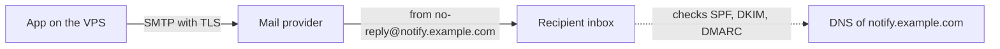
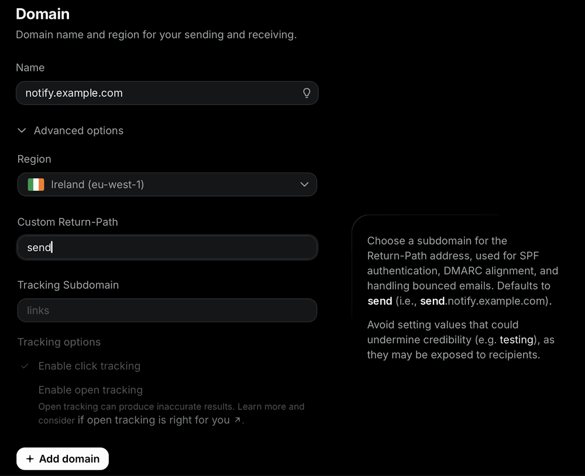
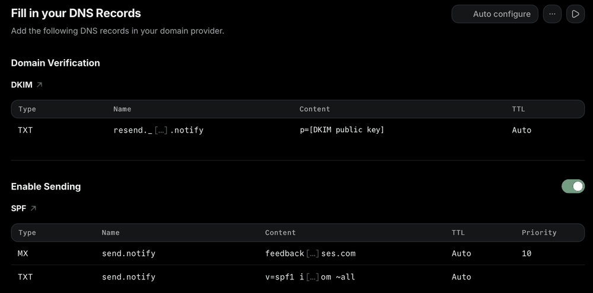
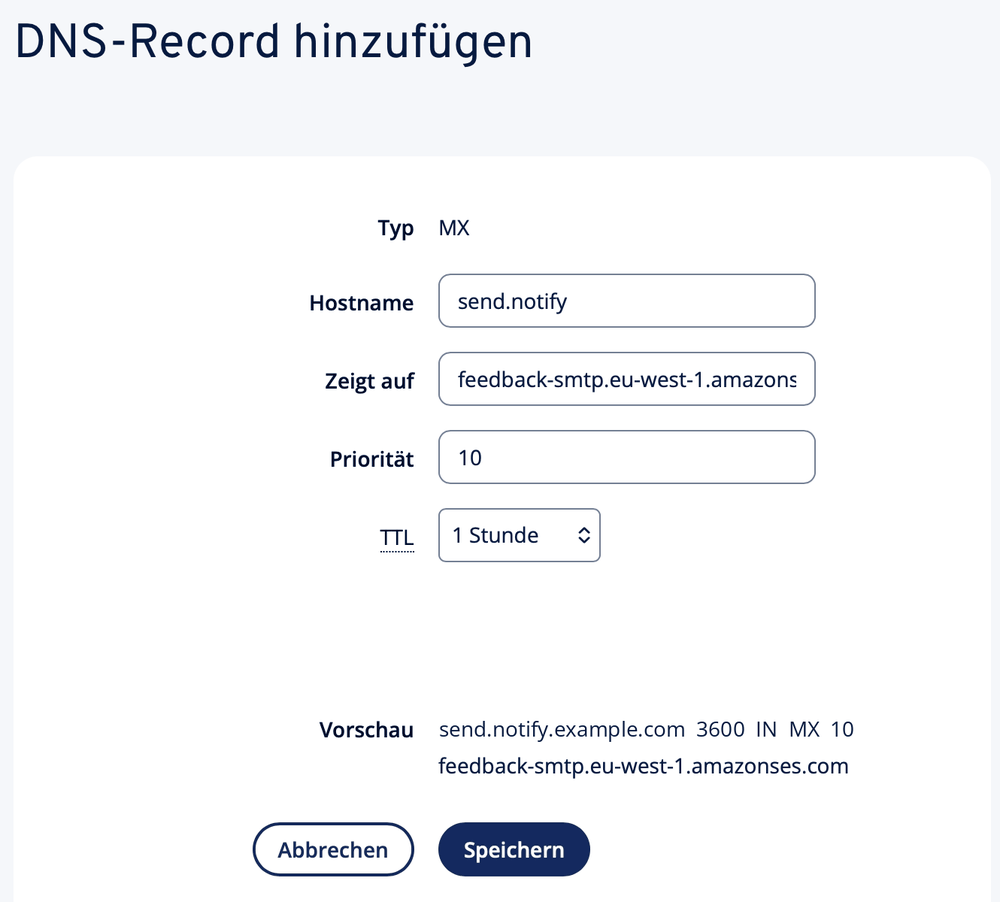
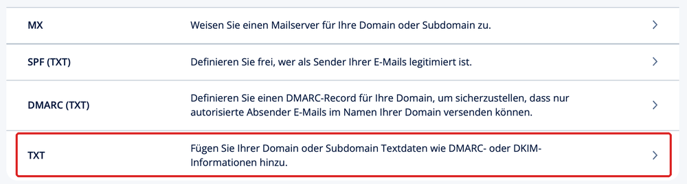

# Mail sending (notify subdomain)

Apps on the VPS send mail through a transactional mail provider over SMTP, for example verification mails, login links and alerts. No mail server runs on the VPS. All apps send from one subdomain, `notify.example.com`. [Bitwarden](setup-bitwarden.md) is the first app that uses it.

Follow the steps in sequence. Each step tells you **where** you do it, **what** you do, the **expected result** and **why**. Replace `example.com` with your domain in all steps. This guide uses Resend as a worked example. Other providers have similar screens with other names.

## Overview



- **Where:** steps 1, 4 and 5 are in the mail provider dashboard. Steps 2 and 3 are in the DNS provider dashboard.
- **Result:** a verified sending subdomain and an SMTP API key.
- **Not affected:** your normal inbox on `example.com` and its DNS records.

## Before you start

- [ ] You can edit the DNS records of `example.com` at your DNS provider. This is often the company where you bought the domain.
- [ ] You have an account at a transactional mail provider.
- [ ] You have a password manager. You get a secret in step 5.

## DNS words in plain English

| Word            | Meaning                                                                                       |
|-----------------|-----------------------------------------------------------------------------------------------|
| Record          | One line in the DNS settings: a name, a type and a value.                                     |
| A / AAAA        | Points a name to an IPv4 / IPv6 address. Used for `vault.example.com`.                        |
| MX              | Tells other mail servers where to deliver mail for a name. Here only for bounces.             |
| TXT             | Free text. SPF, DKIM and DMARC are TXT records.                                               |
| SPF             | A list of servers that can send mail for a name. Receivers check it.                          |
| DKIM            | A public key. The provider signs each mail, and receivers check the signature with this key.  |
| DMARC           | Tells receivers what to do when SPF and DKIM fail, and where to send reports.                 |
| Return-path     | The hidden bounce address of a mail. Undeliverable mail goes back to it, not to you.          |
| TTL             | How long other servers keep a record in their cache. The default (often 1 hour) is correct.   |
| Subdomain       | A name below your domain, for example `notify.example.com`. It needs no website or mailbox.   |
| Host name field | Many DNS panels add `.example.com` for you. Then you type only `vault` or `send.notify`.      |

## Setup

### 1. Add the sending subdomain at the mail provider

**Where:** mail provider dashboard, **Domains > Add domain**.

You need a sending subdomain, for example `notify.example.com`:

- It is only a name for sending. It has no website and no mailbox.
- It starts to exist when you add the provider's DNS records in step 2. You do not create it anywhere else.
- It keeps the reputation of your main domain separate. A problem with sent mail does not affect your normal inbox on `example.com`.
- Other apps on the server can use the same subdomain later.

Do not use `mail.example.com`. It looks like a webmail address, and you may want that name later.



Fill in the form:

| Field              | Value                                                                                    |
|--------------------|------------------------------------------------------------------------------------------|
| Name               | `notify.example.com`                                                                     |
| Region             | The region nearest to the server. Choose an EU region to keep data in the EU.            |
| Custom Return-Path | Keep the default `send`. This gives `send.notify.example.com` as the bounce address.     |
| Tracking subdomain | Leave empty.                                                                             |
| Click/open tracking| Off.                                                                                     |

Tracking rewrites the links in a mail. App mails such as Bitwarden's contain security links, so they must stay unchanged. If the tracking boxes are grey without a tracking subdomain, continue. Make sure that tracking is off in the domain settings after step 4.

**Expected result:** the provider shows a list of DNS records for the new domain.

### 2. Add the mail DNS records

**Where:** mail provider dashboard (copy) and DNS provider dashboard (paste).

The provider shows three records. Values differ per account. Always copy your own values.



| Type | Host name (example)             | Purpose                                         |
|------|---------------------------------|-------------------------------------------------|
| TXT  | `resend._domainkey.notify`      | DKIM: the public key for the mail signature     |
| MX   | `send.notify`, priority `10`    | Return-path: bounces go back to the provider    |
| TXT  | `send.notify`                   | SPF: allows the provider to send for the return-path |

For each record:

1. In the mail provider table, click the **copy** button of the value. The table shortens long values with `[...]`. Never type a value by hand.
2. In the DNS provider, add a record of the same type. Use the plain **TXT** type for TXT records.
3. Enter the host name. Many panels add `.example.com` for you. Then type only the part before it, for example `send.notify`.
4. Paste the value. Do not add quotes. Some panels add them for you.
5. Keep the default TTL. Save.

Check the preview before you save. It must show the full name once:



A correct MX preview looks like `send.notify.example.com 3600 IN MX 10 feedback-smtp.<region>.amazonses.com`. Use the exact value that your provider shows.

Notes:

- A warning about an existing SPF or MX record refers to the main domain `example.com`. The new records are on `send.notify`, so they do not replace it. Do not change or delete the records of your normal inbox.
- Some providers offer an **Auto configure** button. It logs in to your DNS provider and adds the records. This is optional. Manual entry works for all DNS providers.

**Expected result:** all three records are saved in the DNS provider.

**Why:** receivers check these records. Without them, mail goes to spam or is refused.

### 3. Add a DMARC record

**Where:** DNS provider dashboard.

Choose the plain **TXT** type. Do not use a special DMARC wizard. Some wizards create the record only for the main domain.



| Type | Host name       | Value               |
|------|-----------------|---------------------|
| TXT  | `_dmarc.notify` | `v=DMARC1; p=none;` |

The preview must show `_dmarc.notify.example.com`. If `example.com` already has a `_dmarc` record, do not change it.

The `p` value tells receivers what to do with a mail that fails SPF and DKIM:

- `p=none` – deliver it as usual. Use this at the start.
- `p=quarantine` – put it in the spam folder.
- `p=reject` – refuse it.

Change to `quarantine` after some weeks without delivery problems. Change to `reject` later. Then nobody else can send mail as `notify.example.com`.

**Why:** DMARC links SPF and DKIM to the sender address that people see.

### 4. Verify the domain

**Where:** mail provider dashboard.

Click **Verify DNS records**. Verification usually takes some minutes. In rare cases it takes some hours.

**Expected result:** the domain status changes to **Verified**. If it stays pending, see [Troubleshooting](#troubleshooting).

Do not turn on **Receiving**. The apps only send mail. A reply to `no-reply@notify.example.com` bounces. This is normal.

### 5. Create the SMTP API key

**Where:** mail provider dashboard, **API Keys > Create API key**.

1. Give the key a name, for example `bitwarden`.
2. Select **Sending access** only.
3. Limit the key to the domain `notify.example.com`.
4. Copy the key and put it in your password manager at once. The provider shows it only once.

The API key is the SMTP password. Never paste it into a chat, an issue or the repository.

**Why:** a key with sending access for one domain only cannot read mails or change the account. If it leaks, delete it and create a new one.

Worked example for Resend. Other providers use other values. Find them in the SMTP section of their docs.

| Setting  | Resend value      | Note                                                   |
|----------|-------------------|--------------------------------------------------------|
| Host     | `smtp.resend.com` |                                                        |
| Port     | `2465`            | Implicit TLS: TLS starts at once                       |
| `ssl`    | `true`            | Required for implicit TLS                              |
| Username | `resend`          | The same for all accounts                              |
| Password | The API key       | Secret                                                 |

Port rules for Bitwarden on a Hetzner server:

| Port              | `ssl`   | Result                                                       |
|-------------------|---------|--------------------------------------------------------------|
| Implicit TLS port | `true`  | **Recommended.** For example `2465`.                         |
| 587               | `false` | Bitwarden uses STARTTLS only when the server offers it.      |
| 25 or 465         | –       | Hetzner blocks outbound traffic on these ports by default.   |

Use these values in the settings of the app, for example in step 7 of [setup-bitwarden.md](setup-bitwarden.md).

## Troubleshooting

**The domain stays pending at the mail provider.** On your local machine, query each record:

```bash
dig +short TXT resend._domainkey.notify.example.com
dig +short MX send.notify.example.com
dig +short TXT send.notify.example.com
dig +short TXT _dmarc.notify.example.com
```

Each command must print the value from the provider. Compare the DKIM value with the copy button value. A missing end is the most frequent error.

**`dig` shows nothing.** Wait for the TTL, then try again. Query the name with the domain twice, for example `send.notify.example.com.example.com`. If that prints the value, the panel added `.example.com` again. Fix the host name. Ask the DNS server of your provider directly: find it with `dig +short NS example.com`, then run `dig +short MX send.notify.example.com @<NAME_SERVER>`.

**The verification mail does not arrive, or it goes to spam.**

1. Look in the provider's log of sent mails. It shows if the mail was sent, delivered or bounced.
2. If the mail is not in the log, the app could not send it. Read the app logs. For Bitwarden: `sudo grep -ri smtp /opt/docker/bitwarden/logs | tail`.
3. Test the connection from the VPS: `timeout 5 openssl s_client -connect smtp.resend.com:2465 -brief </dev/null`. It must show a TLS connection. A timeout means a blocked port.
4. Check host, port, TLS setting, user and key in the app's settings. Recreate the container after a change: `docker compose up -d --force-recreate`.
5. In the spam folder, open the mail headers. Look for `spf=pass`, `dkim=pass` and `dmarc=pass`. Mark the mail as not spam.
