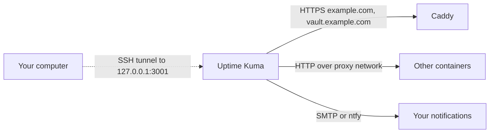
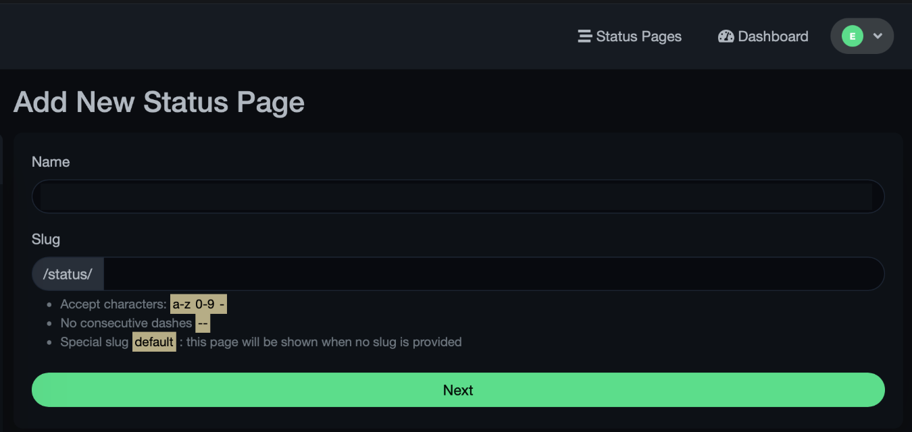

# Uptime monitoring (Uptime Kuma)

Self-hosted uptime checks via [Uptime Kuma](https://github.com/louislam/uptime-kuma) on the VPS. Uptime Kuma opens your websites and services at an interval. It sends a notification when one is down or when its TLS certificate is about to expire.

Follow the steps in sequence. Each step tells you **where** you do it, **what** you do, the **expected result** and **why**. Replace `example.com` with your domain in all steps.

## Overview

- **One container** – web UI, checks and notifications. The database is one SQLite file in the data folder.
- **No public ports** – the web UI is published only on the loopback address `127.0.0.1:3001` of the server. You open it through an SSH tunnel, like the [wg-easy UI](setup-vpn.md#accessing-the-admin-ui) and the [Bitwarden admin panel](setup-bitwarden.md#reach-the-admin-panel-safely).
- **No Caddy change** – nothing in the Caddyfile changes. A public status page is optional, see [Optional: a public status page](#optional-a-public-status-page).
- **Rootless** – the container runs as UID `1000`, with no Linux capabilities.
- **Pinned image** – the image is pinned by tag and digest. It never uses `latest`.
- **Fixed configuration** – `compose.yaml` has no lines to comment in or out.

CPU, memory, disk and per-container resource monitoring is out of scope for this guide.

### How the parts connect



### Words used in this guide

- **Loopback address (`127.0.0.1`)** – the server talking to itself. Programs on the server can connect to it. Nobody on the internet can.
- **SSH tunnel (port forwarding)** – SSH listens on a port on your computer and carries the traffic through your encrypted SSH connection to a port on the server. While the session is open, `http://localhost:3001` on your computer is the Uptime Kuma UI.
- **Monitor** – one check in Uptime Kuma, for example "open `https://example.com` every 60 seconds".
- **Digest (`sha256:...`)** – a fingerprint of one exact image. A tag can move to a new image later. A digest cannot.

### Order of the steps

| Step | Where                   | What                                  |
|------|-------------------------|---------------------------------------|
| 1    | VPS over SSH            | Check the image                       |
| 2–4  | VPS, local Mac terminal | Create the folders and copy the file  |
| 5    | VPS over SSH            | Start Uptime Kuma                     |
| 6–7  | Browser via tunnel      | Create the admin user, add monitors   |
| 8    | Browser via tunnel      | Set up notifications                  |

## Before you start

- [ ] The server runs as in [setup-server.md](setup-server.md): Docker, Caddy, the `proxy` network.
- [ ] You can log in over SSH, either with a Host alias from `~/.ssh/config` (`ssh myserver`) or typed out (`ssh holu@<SERVER_IP>`). This guide shows both forms where you type an SSH command.
- [ ] The server has about 200 MB free RAM and 500 MB free storage.
- [ ] Optional, for mail alerts: a sending subdomain and SMTP credentials as in [setup-mail-sending.md](setup-mail-sending.md). Use a separate API key for monitoring. Then you can revoke one key without breaking the other services.

## Decisions and why

| Decision | Why |
|----------|-----|
| UI on `127.0.0.1:3001` and an SSH tunnel, not behind Caddy | The UI shows your service layout and holds notification credentials. Only someone with SSH access can reach it, even if the app has a login bug. |
| No IP allowlist in Caddy | With Docker's default network setup, Caddy sees every visitor as the Docker gateway (for example `172.18.0.1`). An IP rule then blocks everyone or nobody. |
| Rootless image (UID `1000`), `cap_drop: ALL`, `no-new-privileges` | Uptime Kuma does not need root. If it is compromised, the attacker has fewer rights. |
| On the `proxy` network | It can check containers on `proxy` by name (for example `http://webfolio:8080`) without public ports. Bitwarden is not on `proxy`, so its check uses the public address. |
| SQLite, not MariaDB | One file, no extra container, simple backups. |

## Setup

### 1. Check the image

**Where:** VPS over SSH.

```bash
ssh myserver
# or typed out:
ssh holu@<SERVER_IP>
```

```bash
docker buildx imagetools inspect louislam/uptime-kuma:2.5.9-rootless | grep -m1 Digest
```

**Expected result:** the digest is the same as the digest in `compose.yaml`. **Why:** with `tag@digest`, Docker uses only the digest. The check proves that the pinned image is the published one.

### 2. Create the folders

**Where:** VPS over SSH.

```bash
sudo mkdir -p /opt/docker/uptime-kuma/data
sudo chown $(whoami):docker /opt/docker/uptime-kuma
chmod 750 /opt/docker/uptime-kuma
```

**Expected result:** `ls -ld /opt/docker/uptime-kuma` shows `drwxr-x--- holu docker`.

### 3. Give the data folder to the container user

**Where:** VPS over SSH.

```bash
sudo chown 1000:1000 /opt/docker/uptime-kuma/data
sudo chmod 700 /opt/docker/uptime-kuma/data
```

**Expected result:** no output. **Why:** the rootless image runs as UID `1000` and must write its database there. Other users on the server cannot read the database, which holds notification credentials. Note: if `id -u` prints `1000` for `holu`, `holu` also owns the folder. That is fine: `holu` can already manage every container.

### 4. Copy the file to the server

**Where:** local Mac terminal, in the repository folder.

```bash
scp deploy/uptime-kuma/compose.yaml myserver:/opt/docker/uptime-kuma/
# or typed out:
scp deploy/uptime-kuma/compose.yaml holu@<SERVER_IP>:/opt/docker/uptime-kuma/
```

Then on the VPS:

```bash
chmod 640 /opt/docker/uptime-kuma/compose.yaml
```

**Why:** see [file-permissions.md](file-permissions.md). The file has no secrets, so `640` is enough.

### 5. Start Uptime Kuma

**Where:** VPS over SSH.

```bash
cd /opt/docker/uptime-kuma
docker compose config --quiet
docker compose up -d
docker compose ps
```

**Expected result:** `uptime-kuma` shows `Up` and, after a minute, `healthy`. `sudo ss -tlpn | grep 3001` shows only `127.0.0.1:3001`.

### 6. Open the UI and create the admin user

**Where:** local Mac terminal, then browser.

Open a tunnel. Keep this terminal open while you use the UI:

```bash
ssh -L 3001:127.0.0.1:3001 -N myserver
# or typed out:
ssh -L 3001:127.0.0.1:3001 -N holu@<SERVER_IP>
```

`-L 3001:127.0.0.1:3001` means "port 3001 on my computer goes to `127.0.0.1:3001` on the server". `-N` means "no shell, only the tunnel". The terminal shows nothing while the tunnel is open.

Open `http://localhost:3001`. Choose **SQLite** as the database. Create the admin user with a long unique password and save it in your password manager. Then turn on two-factor login in **Settings > Security**.

**Why:** the first visitor becomes the admin. Because the UI is reachable only through the tunnel, nobody else can be first.

### 7. Add monitors

**Where:** browser via the tunnel.

Click **Add New Monitor** for each line:

| Monitor type | URL or host                         | Why |
|--------------|-------------------------------------|-----|
| HTTP(s)      | `https://example.com`               | The public website, through Caddy and TLS, as visitors see it |
| HTTP(s)      | `https://vault.example.com/alive`   | Bitwarden, through Caddy and TLS. It also catches Caddy and certificate problems. Bitwarden is on its own network with Caddy only, so Uptime Kuma cannot reach it internally, by design |
| DNS          | `example.com`                       | Your DNS records still resolve |

For the HTTPS monitors, turn on **Certificate Expiry Notification**. Caddy renews certificates by itself. This alert tells you when renewal fails. Set **Retries** to `3`, so that a short network problem does not send an alert.

**Expected result:** all monitors turn green within a few minutes.

### 8. Set up notifications

**Where:** browser via the tunnel.

Open **Settings > Notifications > Setup Notification**. Two generic choices:

- **Email (SMTP)** – use the sending subdomain from [setup-mail-sending.md](setup-mail-sending.md), for example `monitor@notify.example.com`, and its SMTP host, port and API key.
- **ntfy** – push messages to your phone. Install the ntfy app. Choose type **ntfy**, server `https://ntfy.sh` and a long random topic. Generate one with:

  ```bash
  openssl rand -hex 16
  ```

  The topic name is the only protection on the public ntfy server: anyone who knows it can read the messages. Never use a guessable name, and keep it out of the repository.

Turn on **Default enabled** and **Apply on all existing monitors**. Click **Test**.

**Expected result:** a test message arrives. Stop a container for a moment (`docker stop webfolio`, then `docker start webfolio`) to see a real down and up alert.

## Open the UI later

For daily use, add a `LocalForward` line to the `myserver-admin` entry in `~/.ssh/config` on your computer (see [setup-vpn.md](setup-vpn.md)):

```
Host myserver-admin
    HostName <SERVER_IP>
    User holu
    LocalForward 51821 127.0.0.1:51821
    LocalForward 3001 127.0.0.1:3001
```

If the entry already exists, add only the `LocalForward 3001` line. Then `ssh -N myserver-admin` opens all tunnels at once, and Uptime Kuma is at `http://localhost:3001`. Close the session with `Ctrl+C` to close access.

## Optional: a public status page

Uptime Kuma can show a read-only status page (for example `status.example.com`). It is optional. Do it only if other people need it. The page shows the names of your monitors, so give them neutral names.

1. In Uptime Kuma: **Status Pages > New Status Page**. Write `status` in **Slug**. The `/status/` prefix is already there, so the full path becomes `/status/status`. Write a neutral title in **Name**, for example `Service status`. Then add the monitors.


2. Point `status.example.com` to the server (A record, as in [step 1 of setup-bitwarden.md](setup-bitwarden.md#1-point-vaultexamplecom-to-the-server)).
3. Add this block to `/opt/docker/caddy/Caddyfile`. It sends only the status page and the files it needs to Uptime Kuma. Everything else, the login and dashboard included, gets `404`:

```
status.example.com {
    header {
        Strict-Transport-Security "max-age=31536000; includeSubDomains"
        -Server
    }

    @public path /status/* /api/status-page/* /assets/* /upload/* /icon.svg /favicon.ico
    handle @public {
        reverse_proxy uptime-kuma:3001
    }
    handle / {
        redir /status/status 302
    }
    handle {
        respond 404
    }
}
```

4. Validate and reload Caddy:

```bash
cd /opt/docker/caddy
docker compose exec caddy caddy validate --config /etc/caddy/Caddyfile
docker compose exec caddy caddy reload --config /etc/caddy/Caddyfile
```

**Expected result:** `https://status.example.com` shows the status page. `https://status.example.com/dashboard` shows `404`. **Why:** the admin UI stays tunnel-only. The path list may need a change if a new Uptime Kuma version loads files from other paths: check the page in the browser after each update.

## Limits

Uptime Kuma runs on the same VPS that it watches. If the whole VPS is down, it cannot send an alert. For that case, add one free external check from a different provider for `https://example.com`.

## Updates

1. Read the [Uptime Kuma release notes](https://github.com/louislam/uptime-kuma/releases). Look for breaking changes.
2. Get the digest of the new version on the VPS:

```bash
docker buildx imagetools inspect louislam/uptime-kuma:<NEW_VERSION>-rootless | grep -m1 Digest
```

3. In `compose.yaml`, change the tag and the digest. Make a backup (below), then:

```bash
cd /opt/docker/uptime-kuma && docker compose pull && docker compose up -d
```

Do the same in the repository, so that `deploy/uptime-kuma/compose.yaml` matches the server.

## Backups

If you lose the data, you lose history and settings, not user data. A backup still saves you from setting up monitors and notifications again.

| Path | Contains |
|------|----------|
| `/opt/docker/uptime-kuma/data` | SQLite database with monitors, history and notification credentials |

Stop the container before you copy the database, so that the copy is consistent:

```bash
cd /opt/docker/uptime-kuma && docker compose stop
sudo tar -czf ~/uptime-kuma-$(date +%F).tar.gz -C /opt/docker/uptime-kuma data
docker compose start
```

The archive contains credentials. Move it off the server to an encrypted place, then delete it from the server. Uptime Kuma can also export monitors as JSON (**Settings > Backup**), but that export is not complete. Prefer the folder copy.

## Troubleshooting

**The browser shows `connection refused` on localhost:3001.** The tunnel is not open, or the container is not running. Check that the `ssh -L ...` terminal is still open. On the server, run `docker compose ps` in `/opt/docker/uptime-kuma`, and `docker compose port uptime-kuma 3001`. It must print `127.0.0.1:3001`.

**The tunnel says `Address already in use`.** Another program on your computer uses port 3001. Change only the left number, for example `ssh -L 9001:127.0.0.1:3001 -N myserver` (or `holu@<SERVER_IP>`), and open `http://localhost:9001`.

**Uptime Kuma does not start, log shows `EACCES` or `permission denied`.** The `data` folder is not owned by `1000:1000`. Run step 3 again, then `docker compose up -d`.

**An internal check such as `http://webfolio:8080` fails with `ENOTFOUND`.** Uptime Kuma is not on the `proxy` network, or the target container is not on it. Bitwarden is never on `proxy`: check it with `https://vault.example.com/alive`. `docker network inspect proxy | grep uptime-kuma` must print a line.

**Too many alerts.** Increase **Retries** in the Uptime Kuma monitor (for example 5) and the **Heartbeat Interval**. Short network problems then do not wake you.

## Hardening checklist

- `sudo ss -tulpn` shows `3001` only on `127.0.0.1`.
- The admin user has a long unique password and two-factor login on.
- The data folder has mode `700` and owner `1000:1000`.
- The notification credentials are their own SMTP key or a random ntfy topic, not reused from other services.
