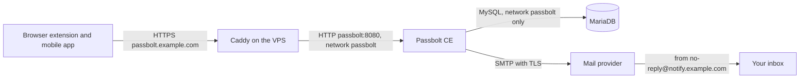

# Passbolt CE

Self-hosted password manager via [Passbolt Community Edition (CE)](https://www.passbolt.com/ce/docker) on the VPS. It runs beside [Bitwarden lite](setup-bitwarden.md) behind the existing Caddy reverse proxy. The vault is at `https://passbolt.example.com`.

Follow the steps in sequence. Each step tells you **where** you do it, **what** you do, the **expected result** and **why**. Replace `example.com` with your domain in all steps.

This is a trial beside Bitwarden, not a replacement yet. Do not delete Bitwarden when Passbolt works. See [Run both, then decide](#run-both-then-decide).

## First, a correction on TOTP

"TOTP" means two different things. Keep them apart before you switch:

| Meaning | In Bitwarden lite | In Passbolt CE |
|---|---|---|
| TOTP as a second factor for your login | Free. This is the authenticator step in [setup-bitwarden.md](setup-bitwarden.md), Hardening | Free. Turn it on in step 13 |
| TOTP seeds stored inside a vault item, so the app shows the 6-digit code next to the password | Needs a Premium license. See [Premium license](setup-bitwarden.md#premium-license) | Free. A TOTP is a normal item type, no license |

So Passbolt CE does give you the second row for free. That is the reason for this trial. The first row was never the problem.

## Overview

- **Two containers** – `passbolt` (web UI, API, mail queue cron) and `passbolt-db` (MariaDB 10.11). Unlike Bitwarden lite, Passbolt has no SQLite mode. A database container is mandatory.
- **Three named volumes** – `database_volume` (MariaDB files), `gpg_volume` (server OpenPGP key) and `jwt_volume` (login token keys). Lose the GPG volume and every stored secret is lost, even with a database backup. See [Backups](#backups).
- **No public ports** – neither container publishes a port. Caddy terminates TLS and sends plain HTTP to `passbolt:8080` over the `passbolt` network. Only Caddy, Passbolt and its database are on this network.
- **Non-root image** – the pinned image is the `-ce-non-root` variant. It listens on 8080 inside the container, so nothing runs as root to bind a low port.
- **Pinned images** – both images are pinned by tag and digest. They never use `latest`.
- **Mail** – the same transactional mail setup as Bitwarden, with its own API key. See [Reuse your mail setup](#reuse-your-mail-setup).
- **Browser extension is required** – on a computer you log in through the Passbolt browser extension, not with a standalone web form like the Bitwarden web vault. The web UI at `passbolt.example.com` is the admin and account screen. It works with the extension. Mobile uses the Passbolt app. Plan for this change in step 12.

Passbolt CE is free and open source (AGPLv3) with no user limit. Paid Pro adds SSO, directory sync and support. None of that is needed here.

### How the parts connect



There is no SSH-tunnel admin panel here, unlike Bitwarden. Passbolt has no separate `/admin` web panel to hide. Administration happens inside the normal UI with an admin account, and on the server with `docker compose exec`. The public site therefore needs no Caddy path block. The admin account itself is the thing to protect: strong passphrase, recovery kit offline, MFA on (steps 12 and 13).

### Order of the steps

| Step | Where | What |
|---|---|---|
| 1 | DNS provider | Point `passbolt.example.com` to the server |
| 2 | Mail provider | Create a second API key on the existing `notify.example.com` domain |
| 3–9 | VPS over SSH, local machine | Create the network, copy files, configure, start |
| 10 | VPS over SSH, browser | Create the first admin account through the setup link |
| 11–13 | Browser, your devices | Install the extension, save the recovery kit, turn on MFA, store a TOTP item |
| 14 | Browser | Optional: import your Bitwarden export for the trial |

## Before you start

- [ ] Bitwarden works as in [setup-bitwarden.md](setup-bitwarden.md), and the server runs as in [setup-server.md](setup-server.md): Docker, Caddy, the `proxy` and `bitwarden` networks, ports 80 and 443 open.
- [ ] The mail domain `notify.example.com` is **Verified** as in [setup-mail-sending.md](setup-mail-sending.md). No new DNS mail records are needed. Step 2 only adds an API key.
- [ ] You can log in over SSH and edit DNS records.
- [ ] You have a safe place for secrets and one offline place (paper or an encrypted USB stick) for the Passbolt recovery kit.
- [ ] The server has at least 1 GB free RAM and 3 GB free storage. MariaDB and Passbolt together use more than Bitwarden lite.
- [ ] You accept the trial rule: new or changed passwords go into one vault only. Two live vaults that both change will drift apart. See [Run both, then decide](#run-both-then-decide).

Write down these values while you work. Keep the secret values out of chats, notes apps and the repository.

| Value | Example | Secret | You get it in |
|---|---|---|---|
| Server IP | `<SERVER_IP>` | No | Your hosting dashboard (step 1) |
| Sender address | `no-reply@notify.example.com` | No | Already exists (step 2) |
| SMTP host and port | `ssl://smtp.resend.com`, `2465` | No | Already known (step 2) |
| Passbolt SMTP API key | A new key named `passbolt` | Yes | Mail provider (step 2) |
| Database password | `openssl rand -base64 32` | Yes | You create it (step 6) |
| Admin email | Your own email address | No | Your choice (step 10) |

## Reuse your mail setup

Yes. Reuse the whole setup from [setup-mail-sending.md](setup-mail-sending.md): the verified domain `notify.example.com`, its SPF, DKIM and DMARC records, and the sender address `no-reply@notify.example.com`. SPF, DKIM and DMARC belong to the sending domain, not to an app. A second app that sends from the same domain needs no new DNS records.

Change only one thing: **give Passbolt its own API key.**

| | Bitwarden | Passbolt |
|---|---|---|
| Sending domain | `notify.example.com` | Same |
| Sender address | `no-reply@notify.example.com` | Same |
| DNS records (SPF, DKIM, DMARC) | Already set | No change |
| API key (SMTP password) | The key named `bitwarden` | A new key named `passbolt` |
| SMTP host, port, user | `smtp.resend.com`, `2465`, `resend` | Same values, one difference in step 6 |

Why a separate key: a key can be revoked on its own. If the Passbolt key leaks, you delete it and Bitwarden mail keeps working, and the other way round. Both keys get **Sending access** only and are limited to `notify.example.com`, as in step 5 of [setup-mail-sending.md](setup-mail-sending.md).

One difference in form, not in substance: Bitwarden takes the host as `smtp.resend.com` with `ssl=true`. Passbolt takes the same implicit-TLS connection as the host `ssl://smtp.resend.com` on port `2465`, with no STARTTLS flag. The `settings.env.example` in this repository already has this form. If you prefer STARTTLS, use host `smtp.resend.com`, port `587` and `EMAIL_TRANSPORT_DEFAULT_TLS=true`. Do not mix the two forms.

Mail is not optional for Passbolt. It sends the account setup and recovery mails, and users cannot finish registration without it. Test it in step 10 before you import anything.

## Setup

### 1. Point passbolt.example.com to the server

**Where:** DNS provider dashboard, DNS settings of `example.com`.

Add one record:

| Type | Host name | Value | TTL |
|---|---|---|---|
| A | `passbolt` | `<SERVER_IP>` | Default |

Many panels add `.example.com` for you, so you type only `passbolt`. The preview must show `passbolt.example.com`, not `passbolt.example.com.example.com`. Add an `AAAA` record only if IPv6 already works for your other sites.

**Expected result:** on your local machine, this command prints `<SERVER_IP>`. It can take some minutes.

```bash
dig +short passbolt.example.com
```

**Why:** Caddy gets the TLS certificate only when the name points to the server.

### 2. Create the Passbolt API key

**Where:** mail provider dashboard, **API Keys > Create API key**.

1. Give the key the name `passbolt`.
2. Select **Sending access** only.
3. Limit the key to the domain `notify.example.com`.
4. Copy the key and put it in your password manager at once. The provider shows it only once.

Do not reuse the Bitwarden key, and do not change any DNS record. See [Reuse your mail setup](#reuse-your-mail-setup).

**Expected result:** you have a new secret key, and the key list shows two keys, `bitwarden` and `passbolt`, both for `notify.example.com`.

### 3. Check Docker and the clock

**Where:** VPS over SSH.

```bash
docker version --format '{{.Server.Version}}'
timedatectl status
free -h
df -h /opt/docker
```

**Expected result:** Docker is 26 or newer, `System clock synchronized: yes`, at least 1 GB free RAM and 3 GB free storage. If the clock is not synchronized, turn on NTP: `sudo timedatectl set-ntp true`.

**Why:** Passbolt checks GPG signatures against the clock. A wrong clock breaks login, not only TOTP codes. Passbolt lists a working NTP service as a system requirement.

### 4. Create the Passbolt network and connect Caddy

**Where:** VPS over SSH.

Passbolt gets its own network, `passbolt`, for the same reason Bitwarden has one: on the shared `proxy` network, every container can reach every other container. Only Caddy joins `passbolt`, plus Passbolt and its database. See [Why a separate network](setup-bitwarden.md#why-a-separate-network).

1. Create the network. This is a one-time setup:

```bash
docker network create passbolt
```

**Expected result:** a long ID. If Docker says that the network already exists, that is fine.

2. Connect Caddy. `/opt/docker/caddy/compose.yaml` must list all three networks, as in `deploy/caddy/compose.yaml` in this repository:

```yaml
    networks:
      - proxy
      - bitwarden
      - passbolt
```

and at the end of the file:

```yaml
networks:
  proxy:
    external: true
  bitwarden:
    external: true
  passbolt:
    external: true
```

If they are missing, copy the file from the repository (local machine: `scp deploy/caddy/compose.yaml myserver:/opt/docker/caddy/`, or typed out `holu@<SERVER_IP>:/opt/docker/caddy/`). Then recreate Caddy:

```bash
cd /opt/docker/caddy
docker compose up -d
docker inspect caddy --format '{{range $name, $net := .NetworkSettings.Networks}}{{$name}} {{end}}'
```

**Expected result:** the last command prints `bitwarden passbolt proxy` in any order. Caddy restarts for a few seconds, so your website and vault are briefly unavailable.

### 5. Create the directory and copy the files

**Where:** VPS over SSH, then local machine in the repository folder.

```bash
sudo mkdir -p /opt/docker/passbolt
sudo chown $(whoami):docker /opt/docker/passbolt
chmod 750 /opt/docker/passbolt
```

```bash
scp deploy/passbolt/compose.yaml deploy/passbolt/settings.env.example myserver:/opt/docker/passbolt/
```

With no Host alias, write `holu@<SERVER_IP>:/opt/docker/passbolt/` instead of `myserver:/opt/docker/passbolt/`.

There are no data folders to create here. The stack uses three named Docker volumes (`database_volume`, `gpg_volume`, `jwt_volume`), which Docker creates on first start. This is a deliberate difference to Bitwarden: MariaDB and Passbolt run as different non-root users, and named volumes let Docker set the ownership. Bind mounts would need two different `chown` lines and break in the same way as a wrong UID always breaks.

### 6. Configure settings.env

**Where:** VPS over SSH.

1. Create the database password and keep it in your password manager:

```bash
openssl rand -base64 32
```

2. Create and edit `settings.env`:

```bash
cd /opt/docker/passbolt
cp settings.env.example settings.env
nano settings.env
```

Replace every placeholder in angle brackets:

| Variable | Value |
|---|---|
| `APP_FULL_BASE_URL` | `https://passbolt.example.com`. Must match the Caddy block in step 8 exactly |
| `MYSQL_PASSWORD` and `DATASOURCES_DEFAULT_PASSWORD` | The same generated password, in both lines |
| `EMAIL_DEFAULT_FROM` | `no-reply@notify.example.com` |
| `EMAIL_TRANSPORT_DEFAULT_HOST` | `ssl://smtp.resend.com` for implicit TLS on 2465 |
| `EMAIL_TRANSPORT_DEFAULT_PORT` | `2465` |
| `EMAIL_TRANSPORT_DEFAULT_USERNAME` | `resend` for Resend, your SMTP user otherwise |
| `EMAIL_TRANSPORT_DEFAULT_PASSWORD` | The new `passbolt` API key from step 2 |

Paste secrets only into `settings.env` on the server. Never write them into a file in the repository.

**Why `APP_FULL_BASE_URL` matters:** Passbolt builds every setup, recovery and notification link from this value. If it still says `https://passbolt.local`, the mails arrive with links that go nowhere. This is the most common first-run error.

### 7. Set file permissions

**Where:** VPS over SSH.

```bash
chmod 640 /opt/docker/passbolt/compose.yaml
chmod 600 /opt/docker/passbolt/settings.env
rm /opt/docker/passbolt/settings.env.example
```

See [file-permissions.md](file-permissions.md) for the full list. Then store a copy of the finished `settings.env` in a safe place off the server, for example as a secure note in Bitwarden.

**Why:** no backup in this guide includes `settings.env`. Without it, a restore needs a new database password and a new SMTP key. See [Backups](#backups).

### 8. Add the Caddy site block

**Where:** VPS over SSH, in `/opt/docker/caddy/Caddyfile`.

```
passbolt.example.com {
    header {
        Strict-Transport-Security "max-age=31536000; includeSubDomains"
        -Server
    }

    reverse_proxy passbolt:8080
}
```

Add no `/admin` block. Passbolt has no separate admin panel to hide. Add no extra header block either. Passbolt sends its own security headers, and a second, different set from Caddy can conflict.

**Why port 8080:** the non-root image serves plain HTTP on 8080 inside the container. Caddy is the only client, over the `passbolt` network, and Caddy terminates TLS. The container also offers HTTPS on 4433. Do not use it here. It would need its own certificate, and Caddy already handles that job.

### 9. Start Passbolt and reload Caddy

**Where:** VPS over SSH.

```bash
cd /opt/docker/passbolt
docker compose config --quiet
docker compose pull
docker compose up -d
docker compose ps
```

The first start creates the MariaDB database, the server GPG key and the JWT keys, and runs the database migrations. This can take a minute. Follow it with `docker compose logs -f passbolt` and stop with `Ctrl+C` when the log is quiet.

Then reload Caddy and test:

```bash
cd /opt/docker/caddy
docker compose exec caddy caddy validate --config /etc/caddy/Caddyfile
docker compose exec caddy caddy reload --config /etc/caddy/Caddyfile
curl -s https://passbolt.example.com/healthcheck/status.json
docker network inspect passbolt --format '{{range .Containers}}{{.Name}} {{end}}'
```

**Expected result:** `docker compose ps` shows `passbolt` and `passbolt-db`, the database as `healthy`. The `curl` command prints a JSON status. The network lists only `caddy`, `passbolt` and `passbolt-db`. Opening `https://passbolt.example.com` in a browser shows the Passbolt page, not a Caddy error.

Run the built-in check inside the container. It tests the database, the GPG key, mail and the application settings in one go:

```bash
cd /opt/docker/passbolt
docker compose exec passbolt /usr/share/php/passbolt/bin/cake passbolt healthcheck
```

**Expected result:** the sections end with `[PASS]`, in particular for GPG, database and application. A `[FAIL]` line names the broken part. Fix that part before you continue. SMTP failures appear when the first mail is sent, in step 10.

### 10. Create the first admin account

**Where:** VPS over SSH, then browser.

This command creates the account. It does not set a password. It prints a one-time setup link, and the browser flow sets your passphrase and creates your private key.

```bash
cd /opt/docker/passbolt
docker compose exec passbolt /usr/share/php/passbolt/bin/cake passbolt register_user \
  -u <YOUR_EMAIL> \
  -f <YOUR_FIRST_NAME> \
  -l <YOUR_LAST_NAME> \
  -r admin
```

If your image variant asks for the `www-data` user, use the form from the [official Docker guide](https://www.passbolt.com/docs/hosting/install/ce/docker/) instead:

```bash
docker compose exec passbolt su -m -c "/usr/share/php/passbolt/bin/cake passbolt register_user -u <YOUR_EMAIL> -f <YOUR_FIRST_NAME> -l <YOUR_LAST_NAME> -r admin" -s /bin/sh www-data
```

**Expected result:** a link like `https://passbolt.example.com/setup/install/<id>/<token>`. Open it promptly. It is a credential.

Then, in the browser:

1. Install the Passbolt browser extension when the page asks for it, if you have not yet (step 11 can also do this first).
2. Set a long passphrase that you use nowhere else. Passbolt cannot reset it for you.
3. Download the **recovery kit** when offered and store it offline. Do not skip this screen.
4. Finish the setup and log in.

This is also the first mail test in part: Passbolt sends a confirmation mail for the account. If no mail arrives, see [Troubleshooting](#troubleshooting) before you go on.

**Why an admin first:** self-registration is off (`PASSBOLT_PLUGINS_SELF_REGISTRATION_ENABLED=false`). Only an admin can create further users, and each new user gets a setup mail. For a single-user trial, this one account is enough.

### 11. Install the extension and the apps

**Where:** each device.

- **Computer:** install the official Passbolt extension for your browser. Open `https://passbolt.example.com`, log in, and confirm that the extension unlocks with your passphrase. There is no Bitwarden-style desktop vault app and no login without the extension. This is the biggest daily-use difference.
- **Phone:** install the official Passbolt app and connect it from the logged-in browser session (profile or settings, mobile transfer). The transfer code is short-lived. Do it at home, not on a shared screen.

Keep Bitwarden installed on every device during the trial. You need it for the export in step 14 and as your fallback.

### 12. Save the recovery kit and back up your private key

**Where:** browser, at home.

Your account private key lives in the browser extension. The recovery kit from step 10 restores it on a new browser. Without the kit and your passphrase, a lost browser profile means a lost vault. The server backup in [Backups](#backups) cannot fix that. It holds the server key, not your user key.

1. Store the recovery kit file offline, for example on an encrypted USB stick, with a note of which account it belongs to.
2. Keep a second copy in a different place.
3. In the extension or web UI, check that account recovery data is complete before you trust the trial with real passwords.

**Expected result:** you can say where both copies are without opening the server.

### 13. Turn on MFA and store your first TOTP item

**Where:** browser, logged in as admin.

1. Open your profile security settings (MFA) and enable **TOTP**. Scan the code with your authenticator app and confirm with a 6-digit code. `PASSBOLT_PLUGINS_MFA_PROVIDERS_TOTP=true` in `settings.env` makes this provider available. Save the MFA recovery codes offline, next to the recovery kit.
2. As an admin, check the administration MFA settings. For a single user, requiring MFA for your own account is enough. Do not enable Duo or YubiKey unless you have those accounts and keys. They need extra credentials in `settings.env`.
3. Create a test item of type **TOTP** for a throwaway service, or add a TOTP to a test password item. Log out, log in, and read the code.

**Expected result:** login asks for the authenticator code, and the test item shows a changing 6-digit code. This is the feature Bitwarden holds behind Premium, here at no cost.

If MFA setup is missing from the UI, recreate the container so it reads `settings.env` again (`docker compose up -d --force-recreate`), then check the healthcheck output from step 9.

### 14. Optional: import your Bitwarden vault for the trial

**Where:** your computer. Do this only when steps 10 to 13 pass.

A Bitwarden export is a plain, readable file. Treat it like the passwords themselves.

1. In Bitwarden, export the vault as **CSV**. An encrypted export cannot be imported by Passbolt.
2. Move the file to your computer only. Never put it on the VPS, in mail, or in cloud storage.
3. In Passbolt, use **Import** and choose the Bitwarden or CSV format. Map the fields if Passbolt asks. Note: TOTP seeds that Bitwarden stored as text may import as notes or custom fields, not always as working TOTP items. Check each one and re-create it as a TOTP item where needed.
4. Open at least five items, including one with a TOTP, and compare them with Bitwarden side by side.
5. Delete the CSV with a secure delete on your computer, and empty the trash.

**Expected result:** the test items match, and no export file remains.

Do not import everything on day one if you only want to test TOTP. Import ten items, live with them for a week, then decide. See the next section.

## Run both, then decide

Run Passbolt beside Bitwarden for a fixed trial, for example two weeks.

- **One vault changes.** During the trial, add and change passwords in Passbolt only for the imported items, and in Bitwarden for everything else. Write down which is which. A password changed in both places will silently disagree.
- **Bitwarden stays your fallback.** Keep its backups, its admin block and its mail key as they are. The trial costs one extra subdomain, one network and about 1 GB of RAM. It changes nothing in the Bitwarden setup.
- **Decide at the end of the trial.** If you keep Passbolt: import the rest, change passwords only in Passbolt for a week, then stop Bitwarden (`docker compose down` in `/opt/docker/bitwarden`) but keep its data and backups for at least a month before you delete anything. If you drop Passbolt: `docker compose down -v` in `/opt/docker/passbolt` removes its volumes, remove the Caddy block and the `passbolt` API key, and Bitwarden is untouched.
- **Never run both as equals for months.** Two vaults double the backup, update and recovery work, and the drift risk above is the usual way people lock themselves out.

## Troubleshooting

**Mail problems** (no setup mail, mail in spam, domain pending). The DNS side is shared with Bitwarden, so work through [Troubleshooting in setup-mail-sending.md](setup-mail-sending.md#troubleshooting) first. Then check the Passbolt side:

```bash
cd /opt/docker/passbolt
docker compose logs passbolt | grep -i -E "smtp|mail" | tail -20
timeout 5 openssl s_client -connect smtp.resend.com:2465 -brief </dev/null
```

The `openssl` command must show a TLS connection. If the log shows an authentication error, the API key is wrong or limited to another domain. If it shows a TLS or connection error, check the two forms in step 6: `ssl://` host with port 2465, or plain host with port 587 and `EMAIL_TRANSPORT_DEFAULT_TLS=true`. Recreate the container after every `settings.env` change: `docker compose up -d --force-recreate`. A restart does not read the file again.

**Caddy returns `502 Bad Gateway`.** Caddy cannot reach `passbolt:8080`. Check `docker network inspect passbolt`. If `caddy` is missing, Caddy is not on the network (step 4) and needs `docker compose up -d` in `/opt/docker/caddy`, not a reload. If `passbolt` is missing, run `docker compose up -d` in `/opt/docker/passbolt` and read its logs.

**Caddy does not start: `network passbolt declared as external, but could not be found`.** Create it once with `docker network create passbolt`, then start Caddy again.

**Setup or recovery links in mail point to `passbolt.local` or the wrong name.** `APP_FULL_BASE_URL` is wrong. Fix `settings.env`, recreate the container, and request a new link. Old links keep the old address.

**The healthcheck reports GPG errors, or login fails after a restore.** The server GPG key and the database do not belong together, or the key is not in the keyring. See the restore notes in [Backups](#backups). Do not delete the GPG volume to "start fresh" while the database holds items you need. That deletes the only way to decrypt them.

**The page loads but shows a security warning or a redirect loop.** Check that `APP_FULL_BASE_URL` starts with `https://`, that Caddy serves the site (not the container's own 4433 port), and that `PASSBOLT_SSL_FORCE=true` is set. Then run the healthcheck from step 9 again. If you changed the URL, clear the browser site data for `passbolt.example.com` and set up the extension again.

**The database container restarts or reports access denied.** `MYSQL_PASSWORD` and `DATASOURCES_DEFAULT_PASSWORD` differ, or the password was changed after the first start. MariaDB sets the password only when it creates the database. Changing `settings.env` later does not change the stored password. Either set both lines back to the first password, or change the password inside MariaDB. For a fresh trial with no items yet, the clean path is `docker compose down -v` and a new first start. That deletes the trial data.

**TOTP codes are always wrong.** The server clock or the phone clock is off. Check `timedatectl status` on the VPS (step 3) and the time setting on the phone. Both must be automatic.

## Hardening

- **MFA on, recovery codes offline** – step 13. An admin account without MFA is the weakest point of this setup, because there is no separate admin panel to hide.
- **Recovery kit offline** – step 12. It is a password equivalent. It does not belong in cloud storage or in the vault itself.
- **No published ports** – `sudo ss -tulpn` must show no `3306`, `8080` or `4433` from this stack. MariaDB must not be reachable from any other container than `passbolt`: `docker network inspect passbolt` lists only `caddy`, `passbolt` and `passbolt-db`, and the database is not on `proxy`.
- **Self-registration off** – keep `PASSBOLT_PLUGINS_SELF_REGISTRATION_ENABLED=false`. Create users by hand as admin.
- **Separate SMTP key** – step 2. Revoke the `passbolt` key alone if it leaks.
- **HTTPS only** – `curl -sI http://passbolt.example.com` must return a redirect to HTTPS, and the healthcheck from step 9 must pass its SSL section.
- **Server basics** – the SSH, update and firewall lines in [setup-bitwarden.md](setup-bitwarden.md), Hardening, protect this stack in the same way. They are not repeated here.

## Updating

Check the [Passbolt releases](https://github.com/passbolt/passbolt_api/releases) about once a month, and at once for security releases.

1. Take a backup first (see [Backups](#backups)) and copy it off the server.
2. Run the healthcheck (step 9) and save the output.
3. Find the new `-ce-non-root` tag on [Docker Hub](https://hub.docker.com/r/passbolt/passbolt/tags) and its digest:

```bash
docker buildx imagetools inspect passbolt/passbolt:<NEW_TAG>-ce-non-root | grep -m1 Digest
```

4. Change the tag and the digest in `deploy/passbolt/compose.yaml`, copy it to the server, then:

```bash
cd /opt/docker/passbolt
docker compose pull
docker compose up -d
docker compose exec passbolt /usr/share/php/passbolt/bin/cake passbolt healthcheck
curl -s https://passbolt.example.com/healthcheck/status.json
docker image prune -f
```

5. Log in through the extension and open an item, including one TOTP item.

The new image migrates the database on start. An old image may not work with a migrated database. To roll back, restore the backup from step 1 and use the old image. Update MariaDB 10.11 only within its supported line, and back up before any database image change.

## Backups

A Passbolt restore needs **four** parts. Missing one makes the rest useless:

| Part | Where it is | Why you need it |
|---|---|---|
| Database dump | MariaDB in `database_volume` | Users, permissions and the encrypted secrets |
| Server GPG key | `gpg_volume`, `/etc/passbolt/gpg` | Decrypts what the database holds |
| JWT keys | `jwt_volume`, `/etc/passbolt/jwt` | Login tokens. Less critical than GPG, still back it up |
| `settings.env` | `/opt/docker/passbolt/settings.env` | Database password, SMTP key, public URL |

Take a manual backup before every change, and store it off the server with the same care as the Bitwarden backups:

```bash
cd /opt/docker/passbolt
mkdir -p ~/passbolt-backup-$(date +%F)
cd ~/passbolt-backup-$(date +%F)
docker compose -f /opt/docker/passbolt/compose.yaml exec -T db \
  mariadb-dump -upassbolt -p<DATABASE_PASSWORD> passbolt > passbolt-db.sql
docker compose -f /opt/docker/passbolt/compose.yaml cp passbolt:/etc/passbolt/gpg ./gpg
docker compose -f /opt/docker/passbolt/compose.yaml cp passbolt:/etc/passbolt/jwt ./jwt
cp /opt/docker/passbolt/settings.env ./settings.env
```

Replace `<DATABASE_PASSWORD>` with the value from `settings.env`. The dump command puts the password in your shell history. Run it with a leading space if your shell keeps history, or read the password from the file first. Then copy the whole folder off the server and delete the copy on the server. The GPG folder holds a private key. Encrypt the backup folder before it leaves the server if your offsite storage is not already encrypted.

For a restore on a fresh stack: start the stack once (step 9), stop the `passbolt` container, load the dump into MariaDB, copy the `gpg` and `jwt` folders back into the volumes with `docker compose cp`, restore `settings.env`, start again, and run `passbolt healthcheck`. If the healthcheck reports that the GPG key is not in the keyring, run the keyring import and the GPG check from the [official backup guide](https://www.passbolt.com/docs/hosting/backup/from-docker/), then repeat the healthcheck. Only a restore test proves the backup: restore on a scratch server or a second stack, log in and open an item.

Note the difference to Bitwarden: there is no built-in daily backup archive here. Until you add a scheduled job (for example the same restic plan as in [setup-bitwarden.md](setup-bitwarden.md#backups-planned), with scope `/opt/docker/passbolt` plus a nightly dump of the database and the two key volumes), backups are manual. Do that scheduled job before the end of the trial if you keep Passbolt.

## Remarks on the existing Bitwarden setup

This section is the review you asked for. Your Bitwarden setup is sound: pinned digest, read-only root file system, no capabilities, separate network, loopback-only admin port with a permanent Caddy block, registration closed after setup, and a scoped SMTP key. Keep it as it is while Passbolt runs beside it. Five remarks, in order of value:

1. **Backups are the one real gap.** [setup-bitwarden.md](setup-bitwarden.md#backups-planned) still says "Not set up yet." A vault without a tested offsite backup is one disk or one bad update away from total loss. Do the restic plan before you invest in a second vault, and include Passbolt in the same job if you keep it. A restore test matters more than the schedule.
2. **The TOTP reason is narrower than it looks.** As the table at the top shows, only TOTP seeds inside items need Premium. If that single feature is the whole reason to switch, price it against a Premium license before you migrate everything. Passbolt still wins on cost and on open source. The trial tells you whether it also wins on daily use, where the required browser extension is its main cost.
3. **No monitoring alert reaches you if the vault dies.** If you followed [setup-monitoring.md](setup-monitoring.md), check that the vault monitor alerts an address you read, and add a monitor for `https://passbolt.example.com/healthcheck/status.json` during the trial. A password manager that is down is usually discovered at the worst moment.
4. **Two vaults double the secret surface.** During the trial, the VPS holds two vault databases and two SMTP keys. That is acceptable for two weeks. It is not a steady state. The decision rule in [Run both, then decide](#run-both-then-decide) exists for this reason.
5. **Small checks worth repeating once.** `settings.env` copies tend to spread. Search your computer and your notes for extra copies and delete all but the one offline copy. And confirm the recovery code for Bitwarden two-step login and the master password are both offline. Passbolt will need the same discipline for its recovery kit, so the habit transfers.

No change to the Bitwarden containers, network or Caddy block is needed for Passbolt. The only shared change is that Caddy joins one more network (`passbolt`, step 4), which does not widen Bitwarden's network: Caddy was already the only bridge, and it still forwards HTTP only.

## Why Passbolt CE?

- **TOTP items at no cost** – the feature that started this trial, free in CE, for stored seeds and for login MFA.
- **Open source, self-hosted** – AGPLv3, no license file, no cloud account, no user limit.
- **Sharing is its home ground** – Passbolt was built for teams, so folders and sharing are stronger than in a personal vault if you ever add a second person.
- **The honest costs** – a mandatory MariaDB container, a server GPG key that must never be lost, a required browser extension instead of a standalone web vault, and manual backups. This guide exists to make those four costs small and visible.


